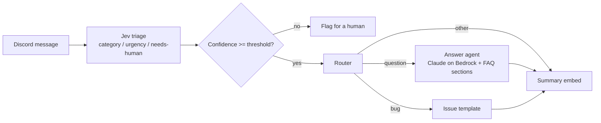

# discord-triage-agent

A Discord support bot that triages every message into typed, confidence-scored judgments with TypeSafe Jev, then routes it to an FAQ-grounded Claude answer, a bug-report template, or a human.

  

## Architecture



Every message in a configured support channel gets a summary embed. Questions can additionally get a drafted answer, and bugs get a pre-filled report.

## How triage works

One request to Jev carries three independent questions about the same message:

| Question | Primitive | Answer used for |
| --- | --- | --- |
| Category: `bug`, `question`, `feature_request`, `other` | Choice | Routing, plus a confidence value |
| Urgency, rubric of three levels | Score | `low` / `medium` / `high` |
| Should a person look at this? | Noul | Probability that overrides automation |

Jev returns typed probabilities instead of text, so there is no prompt-and-parse step. The domain then applies an explicit policy (`src/domain/triage.ts`):

- Category confidence below `TRIAGE_CONFIDENCE_THRESHOLD` becomes `other` and is flagged for a human. The raw pick is still kept and shown by `/triage`.
- Urgency below the threshold falls back to `medium` rather than making a strong claim.
- A needs-human probability of 0.5 or more flags the message regardless of category.
- If Jev is unreachable, the message is handed to a human. The bot never guesses.

Routing is a pure table (`src/domain/router.ts`): a confident `question` with the agent enabled gets a draft answer, a `bug` gets the issue template, anything flagged gets a human hand-off, and everything gets the summary.

The answer agent selects up to three FAQ sections from `knowledge/` by keyword overlap (title matches weigh more), puts them in the prompt, and tells Claude to answer only from that context. No vector database is involved, but `KnowledgeBase` is a port, so retrieval can be swapped for RAG later without touching the domain.

## Quickstart

You need a Discord bot token (with the Message Content intent enabled) and a TypeSafe API key. The answer agent additionally needs AWS credentials with Bedrock model access.

### Local

```bash
npm ci
cp .env.example .env      # fill in the required values
npm run dev
```

### Docker Compose

```bash
cp .env.example .env
docker compose up -d --build
docker compose ps         # shows the healthcheck state
```

Pass the commit shown by `/version` with `BUILD_COMMIT=$(git rev-parse --short HEAD) docker compose build`. To validate the compose file without a real `.env`, run `ENV_FILE=.env.example docker compose config`.

### Commands

| Command | What it does |
| --- | --- |
| `/version` | Shows the running version (and commit, when built with one) |
| `/triage <text>` | Dry run: shows category, urgency, confidence, raw category and threshold. Nothing is posted publicly |

### Development

```bash
npm run typecheck
npm run lint
npm test
```

## Configuration

Validated at startup with zod; a missing or malformed value stops the bot with a message that names the variable.

| Variable | Required | Default | Description |
| --- | --- | --- | --- |
| `DISCORD_TOKEN` | yes | | Bot token |
| `SUPPORT_CHANNEL_IDS` | yes | | Comma-separated channel IDs to listen to |
| `TYPESAFE_API_KEY` | yes | | TypeSafe API key for Jev |
| `DISCORD_GUILD_ID` | no | global | Register slash commands for one server (instant) |
| `TRIAGE_CONFIDENCE_THRESHOLD` | no | `0.6` | Minimum confidence, 0 to 1 |
| `ANSWER_AGENT` | no | `off` | `on` or `off` |
| `BEDROCK_MODEL_ID` | if agent on | | Claude model ID or inference profile in your account |
| `AWS_REGION` | no | `us-east-1` | Bedrock region |
| `AWS_BEARER_TOKEN_BEDROCK` or AWS credentials | if agent on | | Standard AWS credential chain |
| `KNOWLEDGE_DIR` | no | `knowledge` | Folder of markdown FAQs |
| `BUILD_COMMIT` | no | | Short commit shown by `/version` |

## Design decisions

**The classifier and the LLM are separate.** Deciding what a message is and writing a reply are different jobs. Jev answers the first quickly, cheaply and with calibrated probabilities that code can threshold. Claude is only invoked for the narrow subset that benefits from generation, and only when the classifier is confident. Mixing both into one prompt would make routing slow, non-deterministic and hard to test.

**Confidence gates automation.** A wrong confident answer in a support channel costs more than a short wait for a person. Below the threshold the bot says less and hands off. The threshold is one setting because the right value depends on your data; tune it against real messages.

**Three questions, one request.** The questions are independent, so they run in parallel and cost one round trip. Code consumes only the answers it needs.

**Domain, adapters, app.** `src/domain` is pure logic with no SDK imports; an ESLint rule enforces this. `src/adapters` wraps Discord, Jev, Bedrock and the filesystem behind small ports. `src/app` wires them together. Domain code was written test-first, and adapters are tested through fakes, so the suite makes no network calls.

**Fail soft.** Classifier failure, answer failure and Discord errors are logged and degrade to a human hand-off. One bad message does not stop the bot.

```
src/
  domain/     triage policy, router, knowledge selection, prompts, issue template, ports
  adapters/   discord/  jev/  bedrock/  knowledge/
  app/        config, triage service, logger, heartbeat
  main.ts     composition root
knowledge/    sample FAQs the answer agent draws from
```

## Status and limits

The suite covers the domain, the adapters (with fakes) and config validation. The live paths (Discord gateway, Jev, Bedrock) need real credentials and are not exercised by the tests. Slash commands and the message handler are written against minimal interfaces so they can be tested without a gateway.

## Roadmap

- RAG: swap keyword selection for embeddings and a vector database behind the existing `KnowledgeBase` port.
- Metrics: triage counts, confidence histograms and hand-off rate, to tune the threshold from data.
- Multi-tenant: per-server channels, thresholds and knowledge bases.

## License

MIT, see [LICENSE](LICENSE).
